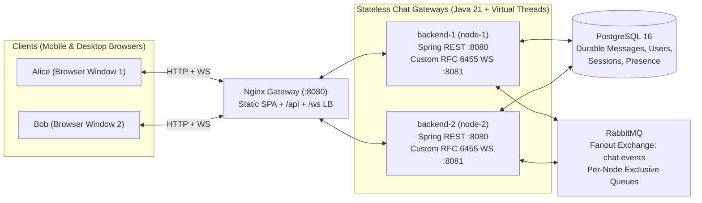
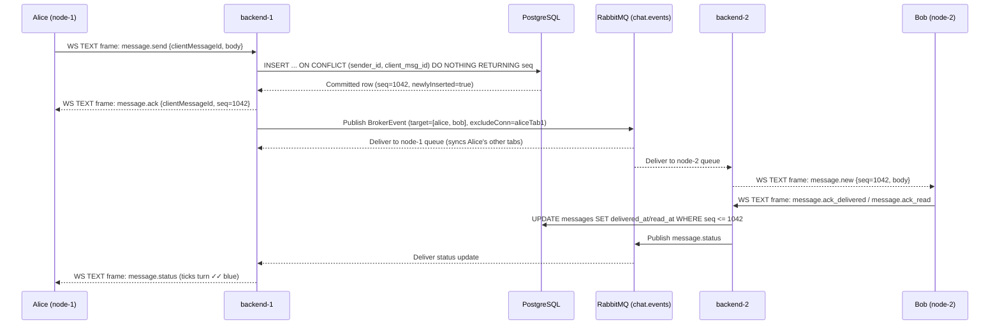

# Architecture & Engineering Design Notes

This document explains the architectural decisions behind PulseChat, the real-world edge cases and race conditions explicitly addressed in the MVP, and the concrete path from this MVP to high-scale production and long-term legacy maintenance.

---

## 1. High-Level Topology

### Responsibility Split ("One Level Deeper" vs. Non-Core Plumbing)
| Layer | Implementation | Why |
| :--- | :--- | :--- |
| **Core Real-Time Transport** (`com.chat.realtime.ws`) | **Custom RFC 6455 WebSocket Server** built from scratch on `java.net.ServerSocket`, `Socket`, `MessageDigest`, `ArrayBlockingQueue`, and Java 21 Virtual Threads. | Built directly on standard library primitives — no `spring-boot-starter-websocket`, STOMP, or Socket.IO. Full control over framing, masking, payload limits, TCP_NODELAY, heartbeats, and per-socket backpressure. |
| **Core Chat Protocol & Hub** (`com.chat.realtime`) | Custom versioned JSON protocol (`v: 1`), `ConnectionRegistry`, `ChatProtocolHandler`, and `MessageBroker` abstraction. | Explicit separation between durable events (messages, receipts) and ephemeral events (typing, presence). |
| **Inter-Node MQ Fan-Out** | RabbitMQ fanout exchange (`chat.events`) with per-node exclusive auto-delete queues (`chat.node.<id>`). | Enables stateless horizontal scaling across multiple backend nodes while PostgreSQL stays the durable source of truth. |
| **Non-Core Plumbing** | Spring Boot Web + `JdbcTemplate` + PostgreSQL + React/Vite. | Explicitly permitted by assessment rules; `JdbcTemplate` keeps SQL concurrency primitives (`ON CONFLICT`, `RETURNING`, partial indexes, `pg_advisory_lock`) completely transparent. |

---

## 2. End-to-End Message Flow

---

## 3. Real-World Edge Cases & Race Conditions Handled

These are specific failure modes encountered in real-time messaging systems serving mixed mobile and desktop clients, and how this codebase mitigates them:

### 3.1 Slow Mobile Consumer Backpressure (`WebSocketConnection.java`)
- **Problem:** When a mobile user enters a tunnel or drops to congested 3G, their kernel TCP receive window shrinks to zero. If a broker listener thread writes directly to that client's `Socket.getOutputStream()`, `write()` blocks — stalling delivery for *every* user on that node (and eventually backing up RabbitMQ consumers).
- **Solution:** Every `WebSocketConnection` owns a **bounded `ArrayBlockingQueue<>(256)`** drained by its own dedicated Virtual Thread writer. Delivery uses non-blocking `offer()`. If a stalled socket fills its queue, we shed **only that slow connection** (`Close 1008 Slow consumer`), leaving every healthy user unaffected. When the mobile client regains signal, it reconnects and catches up via `afterSeq` cursor sync.

### 3.2 Half-Open TCP Sockets on Mobile Network Switches (`RawWebSocketServer.java`)
- **Problem:** When a phone jumps from Wi-Fi to 5G or is suspended by iOS/Android, TCP rarely delivers a clean `FIN` or `RST`. The server's `read()` blocks forever, leaking sockets and leaving users falsely shown as "Online".
- **Solution:** A background heartbeat reaper sends RFC 6455 `PING` frames every 15s and forcibly closes any socket with no activity (`PONG` or data frame) within 45s.

### 3.3 Duplicate Sends on Flaky Mobile Retries (`ChatRepository.java`, `schema.sql`)
- **Problem:** Mobile submits a message, the server commits it to PostgreSQL, and the network drops *before* `message.ack` reaches the phone. The phone retries — naively creating duplicate messages.
- **Solution:** The client generates a `clientMessageId` UUID once per user intent. PostgreSQL enforces `UNIQUE (sender_id, client_msg_id)` with `INSERT ... ON CONFLICT DO NOTHING RETURNING ...`. On retry, the server returns the original persisted row and still replies with `message.ack` (clearing the client's spinner) while skipping redundant RabbitMQ fan-out.

### 3.4 Clock Skew & Out-of-Order Conversations (`schema.sql`)
- **Problem:** Sorting messages by client timestamps breaks whenever a user's laptop/phone clock drifts by even a few seconds.
- **Solution:** Messages are persisted **before** fan-out and assigned a strictly monotonic server sequence (`BIGSERIAL seq`). Both history pagination (`beforeSeq`) and reconnect gap recovery (`afterSeq`) use `seq` as a deterministic cursor.

### 3.5 Concurrent 1-to-1 Conversation Creation Race (`schema.sql`, `ChatRepository.java`)
- **Problem:** If Alice clicks "Message Bob" at the exact millisecond Bob clicks "Message Alice", two concurrent inserts can create two split 1-to-1 threads between the same pair of users.
- **Solution:** `conversations` enforces canonical participant ordering (`CHECK (user_a_id < user_b_id)`) plus `UNIQUE (user_a_id, user_b_id)` with `INSERT ... ON CONFLICT DO NOTHING`.

### 3.6 Multi-Device / Multi-Node Presence Flicker (`ChatRepository.java`, `ChatProtocolHandler.java`)
- **Problem:** If Alice has her phone connected to `node-1` and her laptop connected to `node-2`, closing her laptop tab must *not* broadcast "Alice is offline" to Bob.
- **Solution:** Active connections are tracked globally in `active_connections` with heartbeat timestamps. `presence.update` only broadcasts `online: true` on the `0 -> 1` transition and `online: false` on the `1 -> 0` transition across *all* nodes.

### 3.7 `ConnectionRegistry` Orphaned-Set Race Condition (`ConnectionRegistry.java`)
- **Problem:** In concurrent Java hubs, doing `set = map.get(userId); set.remove(conn); if (set.isEmpty()) map.remove(userId);` races with a reconnecting socket calling `map.computeIfAbsent(userId, ...).add(newConn)`. Thread A can delete the key *after* Thread B inserts into the set, silently black-holing all deliveries to the new socket.
- **Solution:** Both registration and unregistration use atomic `ConcurrentHashMap.compute` / `computeIfPresent` operations so emptiness checks and removals happen under the bucket lock.

### 3.8 Pipelined Frames & Partial TCP Reads (`HttpUpgradeHandshake.java`, `WebSocketFrameCodec.java`)
- **Problem:** TCP is an unframed byte stream. A single `InputStream.read()` often returns partial frame headers/payloads, and a client may pipeline the first WebSocket frame in the same TCP packet as the HTTP Upgrade `\r\n\r\n`.
- **Solution:** `HttpUpgradeHandshake` and `WebSocketFrameCodec` share the **same `BufferedInputStream`** instance (so buffered pipelined bytes are never dropped), and `readExact()` loops until the exact byte count arrives. `socket.setTcpNoDelay(true)` disables Nagle's algorithm to avoid 40–200ms tail-latency stalls on small JSON frames.

### 3.9 Concurrent Multi-Replica DDL Boot Race (`SchemaInitializer.java`)
- **Problem:** When `backend-1` and `backend-2` start together in Docker Compose, parallel `CREATE TABLE IF NOT EXISTS` statements can collide in PostgreSQL's `pg_type` catalog.
- **Solution:** `SchemaInitializer` acquires a PostgreSQL advisory lock (`pg_advisory_lock`) around schema creation and also cleans up any stale `active_connections` rows left by a prior hard crash (`SIGKILL`) of that node ID.

### 3.10 Security: CSWSH & Credential Hygiene (`HttpUpgradeHandshake.java`, `AuthController.java`)
- **Problem:** Passing JWTs in WebSocket query strings (`ws://host/ws?token=...`) leaks credentials into Nginx access logs, proxy caches, and browser history; meanwhile, browser WebSocket upgrades bypass CORS preflight (enabling Cross-Site WebSocket Hijacking).
- **Solution:** Sessions use opaque `SecureRandom` tokens stored as SHA-256 hashes in PostgreSQL and delivered via `HttpOnly; SameSite=Lax` cookies. `HttpUpgradeHandshake` validates both the session cookie AND the `Origin` header before sending `101 Switching Protocols`.

---

## 4. Path From MVP to Production & Legacy Maintenance

If this MVP were promoted toward production (100k–1M+ concurrent users) and maintained over several years, here is the planned evolution path:

1. **Scaling the Inter-Node Broker (Beyond Fanout):**
   - *MVP trade-off:* A RabbitMQ `FanoutExchange` broadcasts every message event to all backend nodes. This is clean and very fast up to ~5–10 nodes, but becomes O(N) wasted network traffic at 50+ nodes.
   - *Production step:* Replace `RabbitMqMessageBroker` (keeping the exact `MessageBroker` interface!) with a **user-location lookup in Redis** (`userId -> Set<nodeId>`) + **DirectExchange** routing directly to `chat.node.<targetNodeId>` (or partitioned Kafka topics / consistent-hashed gateway routing).

2. **Scaling Connection Density (Beyond ~50k–100k Sockets/Node):**
   - *MVP trade-off:* Java 21 Virtual Threads give ~10x simpler, maintainable blocking-style code and easily support tens of thousands of sockets per container.
   - *Production step:* At 500k+ mostly-idle mobile connections per node, swap `RawWebSocketServer` to non-blocking `java.nio.channels.Selector` (epoll/kqueue) so idle sockets hold zero thread stack frames.

3. **Database Durability, Partitioning & Read/Write Separation:**
   - Move DDL from `SchemaInitializer` to versioned **Flyway** migrations executed as an independent CI/CD pre-deploy job (expand-and-contract pattern for zero-downtime rolling updates).
   - Partition `messages` by time (monthly/quarterly range partitions) or `conversation_id` hash to keep hot indexes in RAM and enable cheap archival to S3/object storage.
   - Move high-frequency `active_connections` heartbeat writes out of PostgreSQL into **Redis TTL keys** (`SETEX conn:<id> 45 ...`) to avoid PostgreSQL WAL/vacuum amplification from heartbeats at high connection counts.

4. **Abuse Prevention & Delivery Reliability:**
   - Add per-user token-bucket rate limiting on `message.send` and login endpoints to prevent spam floods and credential stuffing.
   - Implement an **Outbox Pattern** (transactional outbox table + relay) if strict at-least-once broker publication is required even when RabbitMQ is momentarily unreachable during a DB commit.
   - Integrate OS-level push notifications (APNs / FCM) when a recipient has 0 active WebSocket connections.

5. **Protocol Evolution & Legacy Maintenance:**
   - Every WebSocket JSON frame carries an explicit protocol version (`"v": 1`). During rolling deployments or when older mobile app versions remain in the wild, handlers can support `v: 1` and `v: 2` side-by-side cleanly while ignoring unknown additive fields.
   - Structured JSON logging with `correlationId` / `nodeId` / `connectionId`, Prometheus metrics (`ws_active_connections`, `ws_outbound_queue_drops_total`, `message_persist_latency_ms`), and graceful `SIGTERM` draining (sending `Close 1001 Going Away` with staggered client jitter before pod termination).
